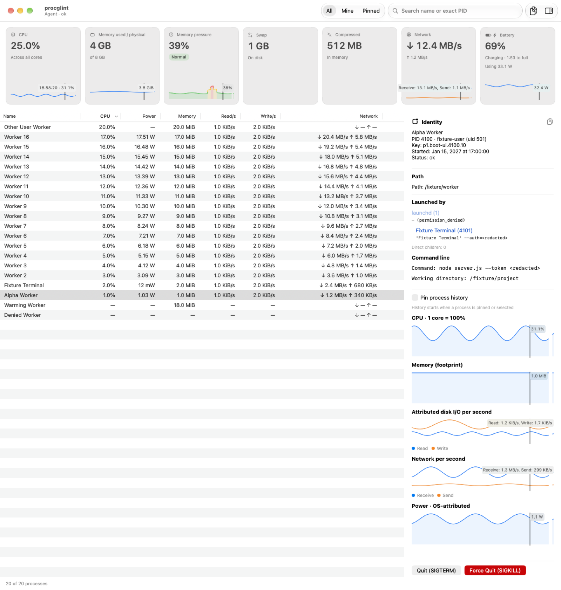
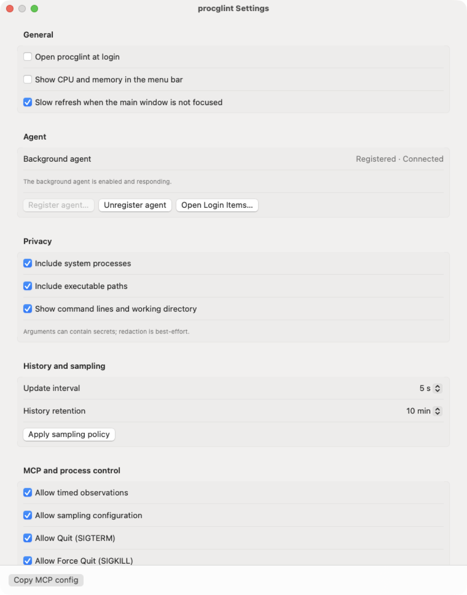

# procglint

A lightweight process monitor for Apple Silicon Macs (macOS 15+). One per-user agent samples the OS; the AppKit app, the bundled stdio MCP server and the CLI share its data, so adding MCP clients does not multiply monitoring cost.

- Contract: [docs/SPEC.md](docs/SPEC.md)
- Plan: [docs/PLAN.md](docs/PLAN.md)

## Screenshots

The screenshots use isolated demonstration data, not a live process list.

<picture>
  <source media="(prefers-color-scheme: dark)" srcset="docs/images/main-dark.png">
  <source media="(prefers-color-scheme: light)" srcset="docs/images/main-light.png">
  
</picture>

<picture>
  <source media="(prefers-color-scheme: dark)" srcset="docs/images/settings-dark.png">
  <source media="(prefers-color-scheme: light)" srcset="docs/images/settings.png">
  
</picture>

## Features

- Process CPU, cumulative CPU time, Memory (footprint) and optional RSS, attributed disk I/O counters/rates, OS-attributed power, PID and owner; system CPU, memory pressure, swap usage and defined VM memory statistics.
- Battery charge, charging/time-remaining state, system power and discharge rate, with health/cycle count in the tooltip. Battery and process power history share the charts’ hover cursor; desktop Macs show no Battery card.
- Search, filter, sort and choose columns; inspect details, pin processes and read bounded history with explicit gaps for unobserved time.
- Copy List / Copy details put Markdown on the clipboard for pasting into an agent; command lines only when enabled.
- Optional CPU/memory menu-bar display. Default updates are 5 seconds for the window and 10 seconds for the menu bar; no periodic sampling without an active lease.
- Shared stdio MCP bridge: read-only, own processes, no paths by default; opt-in bounded observations, configuration and termination.
- Confirmed own-process TERM/KILL with short-lived, single-use tickets, identity revalidation and a bounded audit log. No automatic escalation.
- Monitor diagnostics for collection cost, coverage, failures, connected clients and history usage. No root helper or network listener.

See [MCP](docs/MCP.md), [Security](docs/SECURITY.md) and [Performance and metrics](docs/PERFORMANCE.md). Missing metrics are never zero; process CPU uses 100% per core and may exceed 100%.

## Requirements

Apple Silicon (arm64), macOS 15 or later, and a GUI login session for the per-user LaunchAgent.

## Install

The packaged 1.0 interface is a complete app with bundled agent, MCP bridge and CLI:

```sh
brew install --cask mkusaka/tap/procglint
```

This installs **Procglint.app** to `/Applications` and links `procglint` and `procglint-mcp` into Homebrew's `bin`. Then continue at step 2. Without Homebrew:

1. Download the app ZIP from [GitHub Releases](https://github.com/mkusaka/procglint/releases), unzip it and move **Procglint.app** to `/Applications` before registering the agent.
2. Open the app and click **Register agent…** in the banner above the process table (also available in **Settings…**, ⌘,) to explicitly register its per-user agent (`io.github.mkusaka.procglint.agent`). The app never registers the agent automatically.
3. If approval is required, click **Open Login Items…** and allow Procglint in **System Settings → General → Login Items & Extensions**. Return to the app to re-check; the banner disappears once the agent responds. Use `procglint doctor` for registration state and recovery instructions.

The registered agent starts on demand; the GUI need not remain open for MCP use. With no clients it exits after a 60-second grace period. If unavailable, clients report an error instead of starting another sampler.

For a source-built app, run `scripts/build-app.sh` (Release, ad-hoc signed by default; `--configuration debug` selects Debug, `--sign '<identity>'` selects a signing identity). It writes `build/Procglint.app`; move that complete app to `/Applications` before registration. `swift build` alone does not install/register an app or copy helpers into `/Applications`. See [Releasing](docs/RELEASING.md) for version overrides and release packaging.

## Usage

The process table fills when the background agent is available. If it cannot be reached, the main-window banner explains how to register or approve it; **Settings…** includes diagnostics and the same registration action.

### Battery and power

On Macs with a battery, the **Battery** card shows charge, charging status and the available time estimate. **Using** is system power; **Draining** is battery discharge power and appears only while discharging. They are separate measurements, not a sum of process power. Hover over the card for battery health and cycle count, or over its sparkline for system power history in watts.

The default **Power** column after CPU sorts by OS-attributed average power, displayed in mW or W. It is available for own processes only: it is **not Activity Monitor’s Energy Impact** and does not attribute battery drain. The inspector includes a synchronized Power history chart in watts. Unavailable or warming-up values remain **—**, never zero.

### Which memory numbers matter?

Start with **Memory pressure: Normal / Warning / Critical** in the header. Its green/yellow/red badge also names the state, so colour is not the only signal. Warning or Critical means macOS is having more trouble meeting memory demand; high memory usage alone is not proof of trouble.

The memory cards show **Used … of …**, **Swap …**, and **Compressed …** in memory-style GB/MB (1024-based, matching installed RAM capacities). Swap is memory stored on disk; compression saves RAM. A nonzero swap value can remain after pressure subsides, and compressed memory alone is not a fault. Wired memory is in the card tooltips rather than a separate card. The system chart remains **Memory used / physical**, using the existing active + wired + compressor-page definition (not a reconstruction of Activity Monitor's Used total).

The default process **Memory** column is unchanged `ri_phys_footprint`, the same measure as Activity Monitor's Memory column: memory charged to that process, including compressed and swapped pages. Its header tooltip explains this. **RSS** remains optional; it counts shared pages and is usually misleading when comparing process memory costs. The inspector calls this **Memory (footprint)**. JSON/MCP still use `footprint_bytes`, and memory sorting is unchanged. Unavailable pressure or swap is explicit, never Normal or zero.

**Settings… → Open procglint at login** optionally opens the GUI at login (off by default). This is separate from background-agent registration; MCP can use the agent without opening the GUI. If macOS requests approval, use the hint and **Open Login Items…** button in Settings.

Choose **procglint → About procglint** to see the marketing version and build commit, for example `1.0.0 (abc1234)`. `procglint --version` reports the same bundle metadata without contacting the agent; source builds append `-dirty` for local changes, and missing metadata is shown as `unknown`.

The process inspector's **Launched by** section shows the current parent chain, root first, and direct child count. Click an ancestor to select it if it is in the loaded table. Missing parents, cycles and the 64-hop limit are marked incomplete; this is census ancestry, not historical shell execution tracking. There is no tree mode in the process list.

Command lines and working directories are **off by default**. Enable **Settings… → Show command lines and working directory** to see selectable argv/cwd in the inspector and to permit CLI/MCP opt-in. CLI and MCP additionally require `--include-command-lines`. Arguments can contain secrets: the agent redacts secret-like flag/assignment values, URL userinfo and Bearer tokens before transmission, but this is best-effort. Command lines are capped at 64 arguments, 4 KiB per argument and 16 KiB total; truncation and access failures are explicit. Other users' argv/cwd remain denied. Environment variables and process memory are never exposed. See [MCP detail/redaction rules](docs/MCP.md#where-a-process-came-from).

## Connect an MCP client

Start read-only:

```sh
claude mcp add procglint -- /Applications/Procglint.app/Contents/Helpers/procglint-mcp
```

Settings → **Copy MCP config** generates JSON using the installed helper path. See [docs/MCP.md](docs/MCP.md) for generic JSON, Codex configuration, permissions and all 10 tools. Flags only request access: macOS and app settings still cap it. Your MCP host may forward process results to an external model.

The bundled [procglint skill](skills/procglint/SKILL.md) guides resource investigations and human-confirmed termination.

## CLI

The packaged CLI is `/Applications/Procglint.app/Contents/Helpers/procglint`. Use that absolute path, or put the helper directory on your shell's `PATH`.

| Command | Purpose |
| --- | --- |
| `procglint status [--json]` | Inspect memory pressure/swap and the shared agent's sampling state, overhead and diagnostics; human-readable by default. |
| `procglint doctor` | Report agent registration/reachability and recovery steps, including Login Items approval. |
| `procglint show <pid> [--json] [--include-command-lines]` | Lazy detail and parent chain; redacted argv/cwd require both the flag and Settings permission. |
| `procglint export snapshot [--json\|--csv] [--all]` | Export the top 50 own processes by CPU; `--all` pages through every permitted process in one snapshot. |
| `procglint export history [--series system\|<process_key> ...] [--json\|--csv]` | Export retained history; defaults to `system`. |
| `procglint --help` | Show usage; command/subcommand `--help` is also supported. |

```sh
/Applications/Procglint.app/Contents/Helpers/procglint status
/Applications/Procglint.app/Contents/Helpers/procglint doctor
/Applications/Procglint.app/Contents/Helpers/procglint show 1234 --include-command-lines
/Applications/Procglint.app/Contents/Helpers/procglint export snapshot --csv
/Applications/Procglint.app/Contents/Helpers/procglint export history --series system --json
```

`status --json` preserves the existing diagnostics and adds `system` from a shared snapshot read (`null` if that read fails). It does not start a separate sampler. Snapshot JSON/CSV exports also include memory pressure and swap.

Exports default to JSON. Missing CSV metrics are empty, with separate status columns, never zero. `--all` does not bypass app permissions: CLI process/path scope is capped by the `include_system` / `include_paths` settings. The CLI shares the agent and does not run its own periodic sampler. History cannot recover time when a process was not tracked.

## Architecture

```text
AppKit GUI + menu bar -------------------\
CLI (status / doctor / show / export) -----------+-- XPC --> per-user procglint-agent
MCP host -- stdio --> procglint-mcp ------/          |-- one OS sampler
                                                   |-- snapshot + history
                                                   |-- leases + permissions
                                                   `-- termination + audit
```

launchd starts the agent through `io.github.mkusaka.procglint.agent`. Clients share single-flight collection and scoped results; a connection alone does not request periodic sampling. See [docs/SPEC.md](docs/SPEC.md) for component boundaries and the wire contract.

## Uninstall

1. While the app is still installed, open **Settings… → Unregister agent**. `procglint doctor` diagnoses registration/reachability; it does not unregister the agent or print uninstall instructions. Merely denying Login Items approval is not the same as unregistering the service. For a development registration, use `scripts/dev-agent.sh stop`.
2. Remove procglint from your MCP host configuration, close its bridge connections and quit the app.
3. Remove the app, its application-support directory (including audit logs), and its actual defaults suite. This permanently deletes settings and audit history; keep any records you need first:

   ```sh
   rm -rf /Applications/Procglint.app "$HOME/Library/Application Support/Procglint"
   defaults delete io.github.mkusaka.procglint
   ```

   If the defaults domain does not exist, there are no saved preferences to remove. Monitoring history is in memory and disappears when the agent exits; any exports you saved elsewhere must be removed separately.

## Development

```sh
mise install          # swiftformat, swiftlint, lefthook, XcodeGen
lefthook install
swift build           # package products, not an installed app
```

For a development LaunchAgent, unregister any bundled agent first, then run `scripts/dev-agent.sh start`; `status` inspects it and `stop` removes it. Its label/plist is `io.github.mkusaka.procglint.agent.dev` / `~/Library/LaunchAgents/io.github.mkusaka.procglint.agent.dev.plist`, but it serves the same Mach service as the bundled agent. Never run both registrations together.

## Testing

- **Unit/integration:** `scripts/test.sh` (wraps `swift test`; filter with `--filter CoreTests`). Uses Swift Testing and deterministic fakes; the real bundle build is opt-in.
- **UI:** requires full Xcode, XcodeGen (`mise install`), an unlocked GUI login session, and macOS developer-tools/UI automation approval. Uses XCUITest with an isolated fixture; no LaunchAgent registration or real process termination:

  ```sh
  mise exec -- xcodegen generate
  DEVELOPER_DIR=/Applications/Xcode.app/Contents/Developer xcodebuild \
    -project Procglint.xcodeproj -scheme Procglint -destination 'platform=macOS' \
    -derivedDataPath build/DD CODE_SIGN_IDENTITY=- test
  ```

  For manual fixture screenshots, launch the built app with `--ui-testing --ui-testing-selected`. `PROCGLINT_UI_TEST_APPEARANCE=light` / `dark` selects appearance; `PROCGLINT_UI_TEST_BATTERY=charging` (default), `discharging`, `charged`, `unknown`, or `none` selects the isolated battery fixture.

- **Bundle:** `PROCGLINT_BUNDLE_TEST=1 scripts/test.sh --filter 'bundleBuild|builtAppHasExpectedLayoutMetadataAndSignatures'` builds an ad-hoc Debug app and checks layout, metadata, arm64 binaries and signatures. Replaces `build/Procglint.app`; it does not register the agent or verify notarization.
- **Performance:** `PROCGLINT_PERF=1 scripts/test.sh --filter PerformanceTests` (Release recommended: add `-c release`). Run `scripts/benchmark.sh` for benchmarks; see [docs/PERFORMANCE.md](docs/PERFORMANCE.md) for details.
- **Lint:** `scripts/lint.sh --fix` applies SwiftFormat and runs SwiftLint; `scripts/lint.sh` checks formatting and lint without rewriting files.
